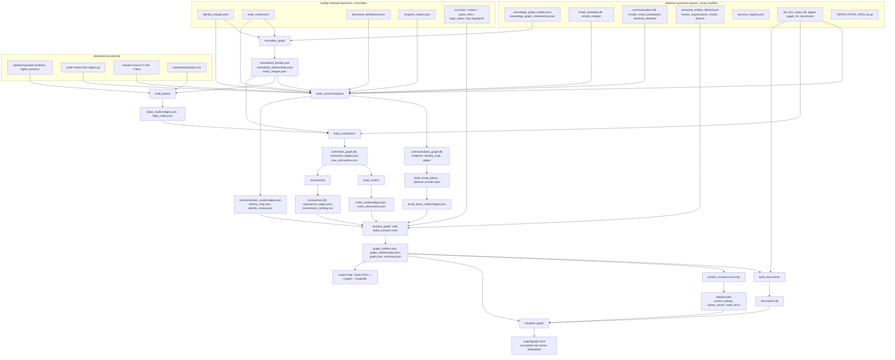

# Document-to-graph pipeline: reuse guide

This guide describes how the pipeline in this repository turns a dump of documents into a reviewed, pseudonymous
relationship graph, and what to change to run it on a different corpus (for example a corrupt or collusive government
contract: officials, companies, agencies, contracts).

It was written from the code. Function names, constants and thresholds were checked against `scripts/` at the time of
writing; anything that could not be verified is marked **(unverified)**. `HANDOFF.md` holds the dated history and the
rationale behind many rules; `README.md` holds the per-layer descriptions. Counts quoted here are illustrative and change
with every build (see `output/summary.json`, `output/communication_summary.json`).

Conventions: paths are relative to the repository root. Run Python with `.venv/bin/python`. Examples use invented names
("Jane Roe", `jroe@example.com`), never people from the data.

Since the 2026-11-10 GDPR review, run `scripts/build.py` from the checkout to produce the audited public `output/`.
Its incremental steps run under `data/private/build_workspace/`; paths such as `output/.build/` below refer to that
private workspace. For manual pipeline commands, change into that workspace first. Data/config/assets are shared with
the checkout; raw working outputs and logs stay private. See section 8.1.1 for the publication boundary.

Contents

1. Overview and architecture
2. Data model
3. Identity resolution, rule by rule
4. Header and OCR repairs before resolution
5. Splitting (per-document attribution, never_merge)
6. Review workflow and config reference
7. Viewer features
8. Privacy and safety model
9. Adapting to a new corpus
10. Neo4j and interchange
11. Known limitations and open items

---

## 1. Overview and architecture

### 1.1 What the pipeline does

1. Reads structured exports of a document dump: a knowledge graph (entities and relationships), parsed email headers, a
   full-text page corpus (SQLite FTS5), extracted contact values, a persons registry, plus optional external data.
2. Normalizes entity names, builds a **pseudonymous communication graph** from email headers (every address and every
   name-only header label becomes an HMAC pseudonym), and repairs OCR damage in headers and addresses.
3. Resolves identities: many raw spellings, addresses and labels collapse onto one canonical node by a fixed list of
   rules, each recorded with a rule name and confidence. Reviewed decisions in `config/` override or block the rules.
4. Adds further layers (places, full-text co-mentions, protected-person designators, same-day presence), combines them
   with the original graph, indexes the documents behind every node and link, and writes a single offline viewer.
5. Keeps real values (addresses, names behind pseudonyms) only under `data/private/`; the viewer embeds them
   **encrypted** and decrypts in the browser with a password.

The output is a document-discovery tool. Every edge is a reading lead with provenance, not a verified relationship.

### 1.2 Data flow



### 1.3 Layers

| Layer | Script | Main inputs | Main outputs |
|---|---|---|---|
| Name normalization | `normalize_graph.py` | upstream KG, `identity_merges.json`, `node_review.json` (persons) | `normalized_entities.json`, `normalized_relationships.json`, `entity_merges.json` |
| Communications | `build_communications.py` | `email_metadata.db`, `communications.db`, external emails, normalized KG, configs | `communication_graph.db`, `communication_nodes.json`, `communication_edges.json`, `identity_map.json`, `identity_review.json`, `communication_summary.json` |
| Places | `build_places.py` | Epstein Exposed `locations.json`/`flights.json`, OurAirports, `place_links.json` | `place_nodes.json`, `place_edges.json`, `flight_index.json` |
| Places in email bodies | `build_email_places.py` (needs `data/private/email_places.db` from `extract_places.py`) | corpus email text, communication graph | `email_place_nodes.json`, `email_place_edges.json` |
| Co-mentions | `build_comentions.py` | corpus FTS, normalized entities, alias registry | `comention_graph.db`, `comention_edges.json`, `new_connections.csv` |
| Protected designators | `build_victims.py` | corpus, co-mention DB | `victim_nodes.json`, `victim_edges.json`, `victim_documents.json` |
| Same-day presence, rankings | `involvement.py` | corpus, KG | `involvement.db`, `copresence_edges.json`, `involvement_ranking.csv`, `presence_timeline.csv` |
| Combination | `analyze_graph.py` -> `build_contacts.main()` | all layer JSON, `extracted_entities_filtered.json`, `identity_map.json` | `graph_entities.json`, `graph_relationships.json`, `graph.json`, `summary.json`, `contact_nodes.json` |
| Document index | `build_documents.py` | combined graph, evidence DBs, corpus | `documents.db`, `documents_summary.json` |
| Private reveal | `private_contacts.py`, `node_documents.py`, `viewer_secret.py` | combined graph, raw headers | `data/private/*` |
| Viewer | `visualize_graph.py` + `viewer/*` | combined graph, `documents.db`, `identity_review.json`, secret table | `output/graph.html` |
| Audits | `audit_coverage.py`, `audit_normalization.py` | various | `audit_coverage.{json,md}`, `normalization_audit.json` |

Helper modules: `corpus_index.py` (cached page-to-document map in `output/corpus_page_map.npz`, parallel FTS lookups),
`fts_cache.py` (cache of corpus queries in `output/.build/fts_cache.db`, invalidated when the corpus file changes),
`doc_urls.py` (official document URLs), `survivor_policy.py` / `victim_policy.py` (protected-person exclusions),
`legal_status.py` (status markers), `airports.py` (airport resolution).

Review and maintenance tools, not build steps: `luna_review.py`, `reocr_pilot.py`, `reocr_full.py`,
`reocr_participants.py`, `reocr_fragments.py`, `find_duplicates.py`, `cooccur.py`, `extract_places.py`,
`reconcile_api_entities.py`, `audit_epsteinexposed_api.py`, `download_corpus.py`, `download_metadata.py`,
`bench_viewer.py`.

### 1.4 Running it and the incremental rebuild

```bash
python3 -m venv .venv && .venv/bin/python -m pip install -r requirements.txt   # requirements-dev.txt adds playwright, OCR engines
scripts/rebuild_all.sh              # incremental; only stale steps rerun
scripts/rebuild_all.sh -n           # dry run: says what would run and why
scripts/rebuild_all.sh --force      # rebuild everything
scripts/rebuild_all.sh --force build_communications   # rerun one step (and what its new outputs change)
scripts/rebuild_all.sh visualize_graph                # that step plus the steps it needs
```

`rebuild_all.sh` runs `scripts/build.py` (extra arguments pass through; `-j N` sets parallel steps, default 3).
Environment variables read by `build.py`:

| Variable | Default | Meaning |
|---|---|---|
| `VIEW_EDGES` | 1500 | highest-record sender/recipient pairs sent to the viewer by `build_communications` |
| `COMENTION_EDGES` | 600 | co-mention pairs sent to the viewer |
| `VICTIM_EDGES` | 800 | designator links sent to the viewer |
| `VIEWER` | `private` | `private`/`both` embed the encrypted real names; `public` skips `private_contacts` and embeds none (`PRIVATE=1` with `public` forces `both`) |

**Step order** (`steps()` in `scripts/build.py`; `after=` lists the dependencies):

```
contact_key            (always runs; validates the HMAC key, writes empty email-place layers if the private input is missing)
audit_normalization
normalize_graph        after contact_key
build_places           after normalize_graph
build_communications   after normalize_graph
build_email_places     after build_communications   (only when data/private/email_places.db exists)
build_comentions       after build_places, build_communications
build_victims          after build_comentions
involvement            after build_comentions
analyze_graph          after build_email_places, build_victims, involvement   (also writes the combined graph)
build_documents        after analyze_graph
audit_coverage         after analyze_graph
export_neo4j           after analyze_graph     (pseudonymous Neo4j CSVs + Cypher + GraphML in output/neo4j)
tests                  after analyze_graph     (unittest discover, log in output/tests.log)
private_contacts       after analyze_graph, build_documents   (only for VIEWER private/both; always runs, untraced)
visualize_graph        after analyze_graph, build_documents, private_contacts
```

**How incremental rebuild works.** Each traced step runs under `scripts/_trace.py`, which uses Python audit hooks and an
`os.stat` wrapper to record every project file the step reads (including imported project modules), writes, lists and
probes for existence. An imported module is read as `scripts/__pycache__/<name>.cpython-NN.pyc`; `relative()` maps that
back to `scripts/<name>.py`, so editing an imported module (even when scripts run with `python -B`, which leaves the
bytecode stale) re-runs every step that imports it. `build.py` stores in `output/.build/state.json` a stamp per step: the command, the Python version
and `requirements*.txt` digests, content hashes of all inputs, listing hashes of listed directories, existence of probed
paths, and content hashes of outputs. A step is stale when any of those changed (or `--force`). Details:

- Files up to 256 MB are hashed (BLAKE2b); larger ones (the raw databases) use size plus mtime. Touching a file does
  nothing; editing a script a step imports does rerun it.
- Dependencies are never listed by hand: if a step starts reading a new config file, the trace picks it up.
- A rerun whose outputs are byte-identical leaves later steps up to date (`-n` prints `maybe` for those).
- `private_contacts` uses worker processes the tracer cannot see, and `contact_key` is cheap, so both are `traced=False`
  and always run.
- A failed step is blocked from stamping and its dependents are skipped; the last 25 log lines print to stderr.
- Logs go to `output/<name>.log`. Reported typical times in `HANDOFF.md`: no-op about 10 s, typical 1-3.5 minutes.

**Tests.**

```bash
.venv/bin/python -B -m unittest discover -s scripts -p 'test_*.py'   # 582 tests on 2026-11-10; no pytest
.venv/bin/python -B scripts/browser_smoke.py                          # headless Chromium against output/graph.html
.venv/bin/python -B scripts/browser_smoke.py --gather-only            # fixture-only double-click gather test (--compact-only is the same)
```

`browser_smoke.py` needs the dev requirements and a system Chromium; it runs headless and requires a real GPU.
It asserts no JavaScript errors, zero dot overlaps at open, legal-status and isolate filters, layout toggle, focus-link
mode consistency, and that every sampled node and link shows documents in the details panel; it writes
`output/browser_smoke.json` and `output/graph_smoke.png`. `bench_viewer.py` measures pan/zoom frame times.
Most rule tests are in `scripts/test_communications.py`; the viewer logic is tested in Node from
`scripts/test_visualization.py` (it loads `viewer/graph_logic.js`).

---

## 2. Data model

### 2.1 Node types (`entity_type`)

Values in the combined graph (`output/graph_entities.json`) with the producing step:

| entity_type | Meaning | Produced by |
|---|---|---|
| `person` | named individual from the upstream KG (flight-log passengers, registry people) | upstream KG via `normalize_graph` |
| `organization` | company, office, agency; also a header-name participant the node review marked `ok_entity`, and a company's automated sender | KG; `build_communications` view nodes |
| `shell_company` | upstream shell company | KG |
| `location` | place; `place_type` gives the subtype (`airport`, `address`, `institution`, `city`, `other`, or classifier output) | `build_places`, `build_email_places` |
| `property` | curated property | `build_places` (location with `type == 'property'`) |
| `aircraft` | aircraft by tail number | KG |
| `email` | pseudonymous email address (`email_<hmac>`) | `build_communications`, `build_contacts` |
| `phone` | pseudonymous phone number (`phone_<hmac>`) | `build_contacts` |
| `participant` | name-only From/To/Cc header label that matched no graph person (`participant_<hmac>`); the viewer shows it as "Participants" | `build_communications` |
| `survivor` | protected person from curated lists, or a censored designator ("Jane Doe 2") | `build_contacts.apply_victim_type`, `build_victims` |

Viewer-only types:

- `airport`: `visualize_graph.main` rewrites `location` nodes with `place_type == 'airport'` to `entity_type: 'airport'`
  for display. The JSON graph files keep `location` with `place_type: 'airport'`. Anything exporting from the JSON files
  must apply the same rule if it wants airports as a separate label.
- `ghost`: not a type. In the viewer, a node hidden only by its type that is the endpoint of a link to a visible node is
  drawn faded as a "ghost" (section 7.4). `n.ghost` is set at runtime in `viewer/app.js`.

Node flags that are not types: `suspected_parse_artifact` (upstream "persons" that are really flight-log route strings,
FOIA record IDs, `Passenger (n)` placeholders, or node-review verdicts `boilerplate`/`ocr_garbage`/
`redaction_or_placeholder`); `label_quality` (`group_or_role`, `uncertain`, `fix_label`, `variant_of_known`, `drop`,
`boilerplate`, `ocr_garbage`, `redaction_or_placeholder`; only this fixed set is exported); `legal_status_flags` and
`legal_status_evidence`; `merged_identities`, `original_entity_ids`, `original_names`, `original_records` (merge audit
trail); `documents` (document index attached by `visualize_graph`).

`survivor` note: config files and some docs call these "victims" (`config/victims.json`, `victim_policy.py`,
`victim_of`), but the entity type written to the graph and shown in the viewer is `survivor`.

### 2.2 Relationship types (`relationship_type`)

| relationship_type | Layer | Meaning (drawn as) |
|---|---|---|
| `sent_to`, `cc_to` | communications | Sender to recipient, from a parsed header. `weight` = source message **records** (not unique real-world emails; the same email appears in several documents). Arrow in the viewer. |
| `header_label_association` | communications | A name shown with an address in a header, where the name equals a graph person exactly. Identity hint, not ownership. |
| `upstream_resolved_header_identity` | communications | The upstream resolver mapped an address to a graph name (confidence >= 0.9, method `exact`/`email`/`manual`). Not confirmed ownership. |
| `header_name_association` | communications evidence only | A name (participant, recovered OCR name) shown with an address. Used by the resolution rules, **never an edge**. Excluded from the `edges` table. |
| `shares_exported_efta_reference` | contacts | A graph name and a contact value share document references in the extracted-entities export. Not ownership or communication. Dashed. |
| `co_mentioned_in_documents` | co-mentions | Two entities' names appear as exact phrases in the same documents (default >= 3 shared). A reading lead. `metadata.new_link` false when the pair is already linked another way. Dashed amber. |
| `victim_document_co_mention` | designators | A censored designator and an entity share documents, weighted by specificity (1/(names in doc - 1)). Dashed. |
| `same_day_document_mentions` | involvement | Two people dated on the same document dates (flight logs, schedules). Not proof of meeting. Dashed purple. (`same_day_presence` is a legacy name still known to the viewer.) |
| `flew_to_or_from` | places | Person to airport, >= `MIN_FLIGHTS` (2) flights. |
| `mentioned_place_in_email` | email places | Identity to place mentioned in shared email bodies (>= 3 shared documents). |
| place links from `place_links.json` | places | `owned_by`, `home_of`, `used_by`, `visited_by`, `purchase_attempted_by`, `detention_site_of`, `linked_to` (place -> person, with a quoted basis). |
| `traveled_with`, `associated_with`, `communicated_with`, `owned_by`, `victim_of`, `employed_by`, `represented_by`, `paid_by`, `recruited_by`, `related_to` | upstream KG | Upstream assertions; weights have type-specific meaning, not confidence. `victim_of` is an allegation record. |

`EDGE_COLORS`, `CO_MENTION_TYPES` and `edge_title()` in `scripts/visualize_graph.py`, and `RELATIONSHIP_LABELS`/
`CO_MENTION_TYPES` in `viewer/graph_logic.js`, hold the viewer's per-type wording. Unknown types get a default color and
the generic title "upstream weight (type-specific meaning, not confidence)".

### 2.3 IDs

| Form | Where | How made |
|---|---|---|
| `kg:<int>` | graph entities in the communication DB and `identity_map` | the upstream integer id, prefixed. The JSON graph files and the viewer use the bare integer. `build_communications.view_id` strips the prefix; `identity_id` adds it. |
| `email_<24 hex>` | addresses | `contact_id(value, 'email', key)` = `kind + '_' + HMAC-SHA256(key, kind + '\0' + normalized value)[:24]` (`scripts/build_contacts.py`) |
| `phone_<24 hex>` | phone numbers | same function, `kind='phone'`; numbers normalized by `normalize_contact` |
| `participant_<24 hex>` | name-only header labels | `HMAC(key, 'header_label\0' + name_key(label))[:24]` (`Builder._endpoint`) |
| `participant_<24 hex>` for reviewed labels | new people created by `document_attributions.json` | `reviewed_label_identity`: `HMAC(key, 'reviewed_label\0' + label)[:24]` |
| `address_<hex>` | street addresses from email bodies | HMAC in `build_email_places.py`; real value in `data/private/address_lookup.json` |
| `place_<slug>`, `place_airport_<code>` | curated places and airports | `build_places.py`, `build_email_places.py` |
| `victim_<slug>`, designator slugs | protected nodes | `build_contacts.apply_victim_type`, `build_victims.py` |
| edge ids | `message_<24 hex>` (sha256 of `[a, b, kind]`), `contact_ref_<src>_<email>`, `comention_<a>_<b>`, `flew_<person>_<place>`, `<kind>_<place>_<who>`, `victimlink_<designator>_<entity>`, `copresence_<a>_<b>`, `email_place_<identity>_<place>` | each layer script |

**Contact key.** `data/private/contact_hmac.key` (32 random bytes, mode 0600) is created once by
`build_contacts.contact_key()`. `config/contact_key_fingerprint.json` pins its SHA-256. If the key is missing and the pin
or any pseudonymous ID in `identity_merges.json`/`node_review.json` exists, the build refuses to start rather than invent
a new namespace; a fingerprint mismatch also aborts. Keep a private backup of the key: without it every reviewed
pseudonymous ID in `config/` points at nothing. Pseudonymization is not anonymity; low-entropy values (short names) can
be guessed offline if the key leaks.

### 2.4 Evidence rows: raw versus canonical

`output/communication_graph.db` (SQLite) holds:

- `nodes(id, entity_type, label)`: every raw endpoint seen.
- `evidence(source_id, target_id, relationship_type, efta_number, message_index, source_db, source_table,
  source_record_id, date_sent, canonical_source, canonical_target)`: one row per source message record and
  relationship type. `source_id`/`target_id` stay the **raw** endpoint ids (never rewritten, so a merge can be audited or
  undone). `canonical_source`/`canonical_target` are the endpoints after `identity_map` and after the document-level
  attribution passes (section 5).
- `identity_map(member_id, canonical_id, rule, confidence)`: every automatic or reviewed merge.
- `edges`: aggregation of evidence by canonical pair and type (`record_count`, `date_first`, `date_last`), minus
  `header_name_association` rows and minus identity links that a merge collapsed into a self-loop.
- `node_degrees`.

`evidence.efta_number` is the document id (see section 9 about generalizing it); `source_db`/`source_table`/
`source_record_id` locate the original row in `data/raw` (`email_metadata.db` `emails_merged`, `communications.db`
`emails`, or `external:<source>` for dropped `.eml`/`.mbox`/Jmail files).

JSON for the viewer is a bounded slice (`--view-edges`); the complete graph is only in SQLite.

`output/identity_map.json` is the pseudonymous map used by `build_contacts.apply_identity_map` to fold merged nodes into
their canonical node. `output/identity_review.json` per canonical node: `reattributed_in`, `reattributed_out`,
`kept_apart`, `merged_records`.

### 2.5 Public (pseudonymous) versus private

| Area | Contents | Notes |
|---|---|---|
| `data/raw/` | upstream inputs | git-ignored; never modified |
| `data/external/` | optional external sources, re-OCR downloads | git-ignored |
| `data/private/` | contact key, `contact_lookup.json` (pseudonym -> real value, raw spellings), `address_lookup.json`, `contact_duplicates.csv`, `viewer_secret.json`, `viewer_password`, `node_docs/*.html`, review answers (`luna_review/`, `ocr_review/`, `audit/`), email-place DB | git-ignored, files 0600 |
| `output/` | pseudonymous JSON/CSV/SQLite, `graph.html` | git-ignored (`.gitignore` lists `data/` and `output/`). Real names are not written here, except as an encrypted blob inside `graph.html` |
| `config/` | reviewed decisions | **not** git-ignored; reasons may quote names, see section 8 |

**Encrypted reveal.**
`private_contacts.py` writes the plaintext reveal table `data/private/viewer_secret.json` (`reveal`: id -> real value and
possible duplicates; `pages`: node -> private document page; `reasons`: reviewed merge/split reasons keyed by member id,
`attr:<bare>:<owner>`, `apart:<id>`). `visualize_graph` calls `viewer_secret.viewer_secret(entities, path)`, which keeps
only ids of nodes present in this viewer (including merged members and review ids), and encrypts the payload with
PBKDF2-SHA256 (600,000 iterations) -> AES-256-GCM, using the password in `data/private/viewer_password` (minimum 12
characters; set with `viewer_secret.py --set-password`). The HTML carries `{v, iterations, salt, iv, data}` as
`const SECRET`. With no password file or no reveal table, `SECRET` is `null` and the page has no unlock box. With
`--public` (`VIEWER=public`) the encrypted secret is omitted; the local lookup is still refreshed for classification. In the page, `decryptSecret` uses WebCrypto; AES-GCM
authentication means a wrong password throws. On success `applySecret` swaps pseudonyms for real values in node names,
merged identities and review panels, and fills `record.document_page` so "All documents" links work. Anyone holding the
HTML can try passwords offline, so use a long one.

---

## 3. Identity resolution, rule by rule

All rules live in `resolve_identities()` in `scripts/build_communications.py` and run **in this order**. The function's
docstring lists only the first three rules; the code is authoritative. Each rule writes
`mapping[member] = (target, rule, confidence)` into a guarded dict (below); the returned `identity_map` entries are
`(final canonical, rule, confidence)` after following chains. The names below are exactly the strings stored in
`identity_map.rule` (a rule suffix after `:` is part of the string, e.g. `header_name_variant:exact`; the viewer
and `stats['identity_merges']` group by the part before the colon).

### 3.0 The guard that wraps every merge

`GuardedMerges.__setitem__` applies each prospective merge, follows the chain from the member, and **reverts it** if it
(a) forms a cycle or (b) puts both ends of any `never_merge`/`kept_separate` pair under the same final canonical. This is
the "never_merge blocks at cluster level" guarantee: a reviewed chain A -> B -> C cannot connect forbidden endpoints A and
C, and an automatic rule cannot pull an address into a forbidden cluster (covered by
`test_never_merge_blocks_transitive_reviewed_and_automatic_links`). In addition most rules test
`frozenset((identity, target)) in blocked` up front. `blocked` is built from `config/identity_merges.json`
`never_merge` pairs plus `kept_separate[].ids` (`never_merge_pairs()`); an entry must contain exactly two distinct
identities, otherwise `ValueError`.

Limit: this guard exists only in the communications resolver. KG-to-KG merges (integer ids) are applied earlier in
`normalize_graph.normalize` and `never_merge` is not consulted there; integer members of `merges[]` are skipped by
`resolve_identities` (`isinstance(member, str)` filter).

Generic examples below: "Jane Roe" is a graph person (`kg:1`); `jroe@example.com` an address; `participant_x` a header
label.

### 3.1 `reviewed_identity_merge` (confidence from the file: `confirmed` or `probable`)

- **Does:** applies `config/identity_merges.json` `merges[]` where the member is a pseudonymous string id
  (`email_...`, `participant_...`, `phone_...`). The canonical may be a KG integer (stored as `kg:<n>`) or another
  pseudonymous id. Integer members are handled by `normalize_graph` instead.
- **Thresholds:** none; reviewed.
- **Example:** `participant_` label "Jane" and `email_` `jroe@example.com` both reviewed into `kg:1`.
- **Failure modes / guards:** conflicting targets for one member raise `ValueError` in `load_identity_merges`; `never_merge`
  still blocks. The stored rule is a fixed code, never the free-text reason (tests assert private reasons do not leak
  into `identity_map`). `safe_identity_rule` in `build_contacts.py` also rewrites legacy rule strings starting with
  `reviewed`.

### 3.2 OCR variants of addresses: `same_gmail_mailbox`, `ocr_glued_prefix`, `ocr_variant_of_more_frequent_address`

- **Does:** clusters addresses within one **repaired domain** (see `ocr_repair`, section 4.4), most frequent first.
  Count = records where the address is an endpoint, excluding `header_name_association`.
  1. Exact match on the repaired local part with an earlier (more frequent) address: merge.
  2. Else, for local parts of length >= 6, compare to "dominant" addresses (>= 20 records) that have at least 10 times
     as many records: edit distance <= 2 when the local part is >= 8 characters, <= 1 otherwise ->
     `ocr_variant_of_more_frequent_address`.
  3. Else a display name glued on the front ("jroe" + dominant local part): dominant local part >= 10 characters, the
     variant at least 3 characters longer, and its tail within 1 edit of the dominant (1 edit only if the dominant is
     >= 11 characters, else exact) -> `ocr_glued_prefix`.
  Both Gmail addresses with the same mailbox (dots and `+tags` ignored) get rule `same_gmail_mailbox`, confidence
  `confirmed`.
- **Confidence:** `probable`; `needs_review` when the variant is listed in `node_review.json` `ocr_merges` and its
  `review != 'same'`. The viewer shows needs_review merges as such.
- **Example:** `jroe@gmai1.com` (3 records) and `jroe@gmail.com` (900 records): same repaired domain, exact local part,
  merged.
- **Failure modes / guards:** a genuinely different mailbox one letter away (`jroe` vs `jroc`); this is why a re-OCR check
  of the official scans exists (`reocr_full.py`; `same_garble` means the scan really shows the variant) and why `review:
  different` pairs are put in `never_merge`. Short local parts (< 6) are never fuzzy-merged. Short dominant targets are
  excluded from the glued-prefix rule ("hchomsky" would absorb every "...chomsky").

### 3.3 `reviewed_audit_merge` (confidence `reviewed`)

- **Does:** applies `node_review.json` `participants[id].merge_into` (a KG person id) for verdicts `variant_of_known` and
  `fix_label`.
- **Example:** `participant_x` (label "J Roe", reviewed) merges into `kg:1`.
- **Guards:** skipped if the participant already has a mapping or the pair is blocked. Stored rule is a fixed code.

### 3.4 `header_name_variant:<rule>` (confidence `probable`)

- **Does:** a participant label is matched to **exactly one** graph person by `PersonMatcher`
  (graph persons only, excluding `suspected_parse_artifact`, with >= 2 name tokens and a surname of >= 2 letters). Honorifics
  (`HONORIFICS`) and credentials (`CREDENTIALS`: md, phd, esq, jr...) are dropped, "Last, First" is flipped, and a lone
  trailing OCR letter after a long word is cut ("Jane Roe a"). Sub-rules (the suffix):
  - `exact`: tokens equal.
  - `reordered`: surname and given swapped ("Roe Jane").
  - `given_name_variant`: same surname and compatible given name: equal, initial of the other, a >= 3-letter prefix, or a
    `NICKNAMES` entry (bill/william, bob/robert, ted/edward...). Middle names are ignored.
  - `ocr_spelling`: on the "first last" string, 1 edit when it is >= 10 characters, 2 edits when >= 14; skipped when the
    shorter surname has <= 3 letters and the surnames differ (Li vs Ng).
  - `leading_name_<sub-rule>`: more than two words and last word > 3 letters: retry with the first three, then the first
    two words ("Jane Roe New York"). Never discards just one word.
  - `concatenated`: one word equals the unique person's given+surname with >= 8 letters ("janeroe").
  - `ligature_loss`: OCR dropped ligatures and read in/rn/ni as m ("je rey eps em"): the label's letters (>= 8) must be an
    in-order subsequence of exactly one person's name, cover >= 65% of it, and start with the same letter.
- **Failure modes / guards:** two candidates (two Janes named Roe) -> no match at all; same-surname people with different
  first names stay separate. **Couples are skipped** (`couple_words(label.split())`): "Jane and John Roe" is a couple, not
  Jane. `tiny` matches: surname-length guard above. Single-word labels only match through `concatenated` or
  `ligature_loss`.
- The same `PersonMatcher.match` is also used at parse time (`Builder._endpoint`) to **recover garbled labels** that
  `label_quality` would drop ("dee ak cho ra" -> a person) before they become participants.

### 3.5 `header_name_ocr_skeleton` (confidence `probable`)

- **Does:** names equal up to OCR confusions, punctuation, spacing or word order. `name_skeleton_words` folds
  `l/I/i/1/|/!/j -> l`, `0 -> o`, `q -> g`, `rn -> m`, `vv -> w`, drops accents, apostrophes, dots and hyphens.
  `name_skeletons` emits keys `plain:` (letters+digits joined), `joined:` (skeleton words joined) and, for multi-word
  names, `sorted:` (any word order). An apostrophe is tried as nothing and as `i` ("iv'et" / "iviet"). Identities sharing
  a key are unioned (union-find over `final(identity)`).
- **Thresholds:** a key needs >= 5 skeleton letters (>= 3 for `plain:`); labels containing `?` produce no key.
- **Canonical:** the single graph person in the cluster, else the participant with the most records.
- **Example:** "Vincenzo lozzo" and "Vincenzo Iozzo", "Slayton Bobby" and "Bobby Slayton" ("Roe Jane" / "Jane Roe").
- **Failure modes / guards:**
  - A key already shared by two graph people (glued headers "Jane Roe John Doe" and "John Doe Jane Roe") links nothing
    (`by_key` filtered when >= 2 `kg:` ids share it), otherwise it would chain two people's spelling clusters.
  - A cluster with more than one graph person is left alone for review.
  - Couples only match couples (`('couple', key)` namespace).
  - Split fragments of <= 4 letters in total with a one-letter part are skipped: "j es" (a fragment of
    "Jane E <jroe@...>") once merged into the wrong person; this was the first false merge found with the viewer's
    Merged/separated panel.
  - Blocked pairs are skipped.

### 3.6 Fuzzy participant merges: `header_name_truncated`, `header_name_one_edit`, `header_name_two_edits`, `header_name_middle_dropped`, `header_name_first_initial`, `header_name_short_first_name` (confidence `probable`)

Only for identities whose id starts with `participant_` and that are not yet merged (no chains), whose labels read as
names (`name_like`: no `?`, no function words). A label's weight = its record count, plus 10^6 if it is a graph person.
The rules are tried in this order for each participant, lightest first; a rule applies only when it yields **exactly one**
candidate (ambiguity stops all later rules for that label):

| Rule | Condition |
|---|---|
| `header_name_truncated` | >= 2 words, >= 8 letters; target >= 3x heavier; cut at either end covering >= 70% of the target or only the last word cut; the label is rare (<= 20 records) or the target is >= 5x heavier ("Amex Centurion Trave", "Ctacor Rso") |
| `header_name_one_edit` | skeleton >= 6 letters, one edit, same word count, target >= 5x heavier |
| `header_name_two_edits` | >= 2 words, surname >= 7 letters, skeleton >= 10, the label has <= 5 records, target >= 10x heavier, same word count, same first word and same surname initial |
| `header_name_middle_dropped` | same first and last word, in order, one has an extra middle word ("Sultan bin Sulayem" / "Sultan Ahmed bin Sulayem"); target at least as heavy |
| `header_name_first_initial` | two words, first is a single letter, surname >= 4; target has a longer first word starting with that letter, same written initial; **both must be graph persons or node-review `ok_person`/`variant_of_known`/`fix_label`** ("T Roe" -> "Ted Roe") |
| `header_name_short_first_name` | two words, both first names >= 4 letters and one a prefix of the other ("Steve Roe" / "Steven Roe") |

Guards: a name that others already merged into (`absorbed`) can only take on a candidate with the same surname (no
drift); after all fuzzy rules, a **surname consistency pass** deletes any fuzzy mapping whose final landing name does not
share the surname (equal, prefix/suffix, or within 2 edits) with the member's own last word. This fixed a name merged into
a glued header that later moved on to someone else.

### 3.7 `header_name_initial_unique`, `header_name_initial_dominant` (confidence `probable`)

- **Does:** "Nina K" -> "Nina Keita": a two-word participant label whose second word is one letter and first word >= 3
  letters. Candidate full names are "first last" labels with surname >= 3 letters that are graph people or have >= 3
  records, grouped by (first name, surname initial). One candidate -> `_unique`. Several: the top group must have >= 20x the
  records of all others combined and its surname initial must match -> `_dominant` ("Ann R" -> "Ann Rnuruvuze" over leftover misreads).
- **Failure modes:** two real people sharing first name and surname initial and similar volume: no merge.

### 3.8 `header_names_point_to_one_identity` (confidence `probable`)

- **Does:** an **address** whose header names resolve to one identity merges into that identity. Evidence is the
  `header_label_association`, `header_name_association` and `upstream_resolved_header_identity` rows.
  Conditions: the winning name has >= 3 records written with the address, and holds >= 90% of the total (or >= 4 and at
  most one record against); the winner is not itself an `email_`; OCR-damaged spellings of the winner (within 2 edits,
  winner key >= 8 characters) count for it.
- **Vague names:** "weak" labels (a participant of one word, or trailing initials only: "Jane", "Jane R") cannot win an
  address, but vague names that cannot belong to the winner outnumber it count **against** the merge (`fits`
  decides compatibility: same first word, last word present, or 2-4 letter initials matching).
- **Failure modes (documented):** shared or assistant-run mailboxes will match this rule; every such merge is recorded
  for review. Check the rule name before relying on an identity.

### 3.9 `same_account_alias_domain` (confidence `probable`)

- **Does:** one Apple account answers at `me.com`, `mac.com`, `mail.mac.com` and `icloud.com` (`APPLE_DOMAINS`). An
  address with the same exact local part as an address that already resolved to a person joins that person.
- **Guard:** requires exactly one distinct owner; exact local part only.
- **Example:** `jroe525@mail.mac.com` beside `jroe525@me.com` resolved to Jane Roe.

### 3.10 `address_spells_one_name` (confidence `probable`)

- **Does:** an address whose local part spells one person's name belongs to them: for a candidate name (two words, first
  >= 2 letters, surname >= 5 letters) the spelled forms are initial+surname, first+surname, surname+initial,
  surname+first ("jroe" and "janeroe", "roej", "roejane"). Candidates are graph persons, or participants with >= 3
  records whose node-review verdict is `ok_person`/`variant_of_known`/`fix_label`.
- **Thresholds:** exactly one candidate, or one that outweighs the rest 20 to 1 (by records, not the graph bonus).
- **Guards:** if header names on the address point at someone else, no merge. A **namesake at another organization**
  (`jane.roe@othercorp.example`) is excluded: the header names must agree with the person, or the domain must already
  belong to one of their resolved addresses.

### 3.11 `header_name_is_address` (confidence `probable`)

- **Does:** a header display name that is really an address local part ("Je vacation" for `jevacation@...`) belongs to
  whoever that address resolved to. Skeleton of the label >= 8 letters, equal or one edit from the local part (>= 8
  letters), exactly one non-email owner.

### 3.12 `header_name_on_one_identity_addresses` (confidence `probable`)

- **Does:** a header name written almost only on one identity's addresses is that identity's sign-off/label ("Jane",
  "Jane E." on Jane Roe's mailboxes). Requires >= 20 records and >= 95% on the owner; or >= 50 records and >= 90% when the
  surname (or its initial) also fits ("Sarah K"). The first names must be equal and >= 3 letters; the owner is not an
  `email_` id.
- **Failure mode:** an assistant's own name on the boss's mailbox fails the first-name check.

### 3.13 `short_header_name_on_one_identity` (confidence `probable`)

- **Does:** a one-word or initials-only participant label (`weak`) written almost exclusively on one identity's
  addresses is that identity's sign-off ("Bob" for Robert Roe, "JR", "rob"). Needs >= 3 records and >= 90% of the label's address
  records (>= 80% when the label is contained in the address local part, "jroe" in `jroe1@...`). Unresolved OCR variants of
  the winning address (edit distance <= 2, or containing the local part; truncated ends) count toward the winner.
- **Owner checks:** a person/full-name owner must **fit** the label (first name starts with it, or `fits()`), and a trailing
  initial must start the surname ("Brad R" is not Brad Doe); an unresolved address owner needs >= 5 records or to contain the name.
  When the owner is an address the address is the fuller label.
- **~100 merges** at the time of writing (see `HANDOFF.md`).

### 3.14 `same_couple_spelling` (confidence `probable`)

- **Does:** spellings of one couple label ("Lynn and Jlip", "Lyn & Jojo Roe", "Lynn and Jlip Roe") become one node: the
  same two given names up to doubled letters, at most one surname among them, all members `participant_` ids and
  at least two spellings. Canonical: the spelling that has a surname, then the most records.
- **Why couples need their own handling:** `couple_words` (3-4 words, the middle `and` or `&`, no function words or
  sign-off words) keeps them out of `header_name_variant` and the skeleton rule; previously "John and Jane Roe" folded
  into John Roe.

### 3.15 `automated_company_sender` (confidence `probable`)

- **Does:** a company's automated/role senders (`noreply@`, `messages-noreply@bounce.`, `info@`, `orders@`...; local part
  matches `AUTOMATED_LOCAL`) merge into **one identity per company domain**. `automated_company()` computes the registrable
  domain (keeping three labels under `co.uk`-style second levels via `SECOND_LEVEL`), strips an OCR-lost `bounce.` dot,
  and **excludes webmail providers** and big ISPs. The canonical is the reviewed organization header name
  (`ok_entity` verdict) seen on those addresses ("Acme Shop"), else the most frequent address. Addresses that already
  resolved to a person keep that.
- **Display:** such nodes are drawn as `organization` (`build_communications` view-node construction).

### 3.16 After resolution: document-level rules (not in `identity_map`)

`document_names_one_person` and `reviewed_document_attribution` rewrite `evidence.canonical_source/target` per record and
are recorded in `identity_review.json`, not in `identity_map`. They are described in section 5.

### 3.17 Reading the result

`output/communication_summary.json` has `identity_merges` (counts by rule family), `garbled_header_names_recovered`,
`header_labels_dropped_as_non_names`, and per-repair counters. A rough picture of the rule weights from one build: the
OCR-skeleton, one-edit, OCR-address and truncated rules dominate by volume; reviewed merges are a few hundred.

---

## 4. Header and OCR repairs that run before resolution

Everything here is in `scripts/build_communications.py` unless noted. They decide *what the endpoints are*; section 3
decides *which endpoints are one identity*.

### 4.1 Parsing recipients

- `parse_recipient(value)`: accepts a string or `[name, email]` pair. Splits on `,` or `;` outside `<...>` and quotes
  (`RECIPIENT_SPLIT`); `getaddresses` alone ignores `;` and truncates multi-word names. Name-only lists split on `;`
  always, and on `,` only when every piece is multi-word (otherwise `Last, First`). Multi-word name-only recipients listed
  beside addresses are kept; single tokens beside addresses are not (they may be halves of `Last, First`).
- `parse_sender(name, address)`: recovers an address embedded in the sender name when `sender_email` is missing.
- `valid_email(value)`: rejects `example.com/.org/.net` domains, placeholder locals (`unknown`, `redacted`, `none`,
  `noreply-redacted`), `redacted` as a token of the local part or domain, and **inline-image Content-IDs**: a local part
  ending `.png/.jpg/.gif/.bmp/.tif/.emz/.wmz` (`INLINE_IMAGE_LOCAL`, e.g. `image001.png@01D0778D.2D49...` is a MIME
  Content-ID, not a mailbox). The checks are exact (substring checks once dropped `unredacted@...`).
- `unredacted_part`: for Jmail imports, drops redaction block characters so a visible name still links; the hidden text is
  never recovered.

### 4.2 Split webmail addresses: `join_split_addresses`

OCR line breaks split "Jane Roe <jroe@g" | "mail.com>" into two items, and the tail ("mail.com") became a name-only
participant shared by everyone cut there. A fragment is recognised by `domain_fragment` (>= 5 characters, no spaces or
`@`, a suffix of a `WEBMAIL_DOMAINS` entry). When the previous item is name-only, the halves are rejoined if they form a
valid address (`OCR_AT_SIGN` normalizes `(@)`, `®`, `(a)`); otherwise the fragment is **dropped**, never a recipient of
its own. `_endpoint` also refuses any label that is a domain fragment. Two cases stay unidentified: the fragment opens the
list, or the preceding item is too garbled. Those are handled by re-OCR (4.6).

### 4.3 Wrapped names and sign-offs

- `join_wrapped_names(pairs, full_names)`: OCR wrapped one name into two list items ("...; Michael" | "Glidden").
  Adjacent one-word name-only items are joined when `wrapped_pair` yields a two-word name (or a couple) **and** that
  name occurs at least `MIN_WRAPPED_FULL_NAME = 20` times as a whole header name elsewhere (`wrapped_full_names`, built from
  all senders and recipients). The second item's address is kept. The first word may not be in `NOT_GIVEN_NAMES`
  ("thanks", "regards", "dear"...). Couples ("Lynn and" | "Jojo") are rejoined the same way. About 4.1k items rejoined
  on the real corpus.
- `signed_own_name(name, address, sender_name)`: a one-word name-only "recipient" equal (casefolded, >= 3 letters) to the
  sender's **first name** is the sender's body sign-off ("Thanks! / Jane") leaked into the recipient list, and is dropped
  (`sender_signoff_recipients_dropped`, about 10k items). The sender's name must have >= 2 words.

### 4.4 Address OCR repair

`ocr_repair(email)` returns `(local, domain)` **for clustering only, never a display value**: strips `mailto:`-style
prefixes (including misspelled ones, `MAILTO`), strips mail-server labels before webmail domains (`imap.gmail.com`),
maps `rn -> m` in the domain, snaps a domain base within 1 (providers < 5 letters) or 2 edits of a known provider
(`PROVIDERS`: gmail, yahoo, hotmail...) to that provider, repairs garbled TLDs (`.corn`, `.eom`, `.coml`...) for known
providers, and folds Gmail dots and `+tags`. `ocr_artifacts(email)` labels visible damage (`mailto_prefix`,
`misspelled_provider`, `garbled_tld`) and is exported per merged member so a reviewer can see the damage.

### 4.5 Header-label quality: `label_quality`

Applied in `Builder._endpoint` to name-only labels: returns `drop`, `group_or_role` or `ok`. Dropped: no letters; hyphenated
mail-client field names (`date-last-viewed`); `BOILERPLATE_TOKENS` words (regards, subject, attachment, unsubscribe...);
quote headers ("On Fri"); function-word phrases (`FUNCTION_WORDS`: single function word, or >= 2 making up >= half
the words); runs of two-letter fragments ("oog e a en ar"); stroke noise (`III`, `MINIII`); labels of <= 2 letters; single
`NON_NAME_WORDS`. Roles (`ROLE_TOKENS`: assistant, office, desk...) are kept but flagged `group_or_role`. A dictionary-based
rule was tried and rejected because it dropped real first names. Before dropping, the label goes through `PersonMatcher` so a garbled
but recognisable person is linked instead (`garbled_header_names_recovered`). Labels with verdicts in `DROP_VERDICTS`
(`boilerplate`, `ocr_garbage`, `redaction_or_placeholder`) in `node_review.json` are dropped at parse time.
Other rejections in `_endpoint`: labels of < 2 or > 80 characters or > 6 words, non-alphabetic characters, `redact`,
`undisclosed recipients`.

### 4.6 Re-OCR cross-checks and recipient repairs

Tools in `scripts/` that return to the original scans (all need the optional OCR requirements and write only pseudonymous
IDs into shared files):

- `reocr_pilot.py`: samples documents behind OCR-variant merges, downloads the official PDF, re-OCRs with Tesseract, and
  classifies each variant `confirmed` (fresh OCR reads the canonical address), `same_garble` (the garble is in the scan) or
  `neither`. Note the DOJ age-gate click, which is Epstein-specific (section 9).
- `reocr_full.py`: every `ocr_variant_of_more_frequent_address` merge, one document per variant, three readings (PDF text
  layer, Tesseract, RapidOCR). Output `output/reocr_full.json`. Variants where both engines re-read the variant itself
  on every checked scan (`same_garble`) are listed in `node_review.json` `ocr_merges` (still merged, confidence
  `needs_review`).
- `reocr_participants.py`: private; re-reads header lines behind truncated-looking participant labels, writes
  `data/private/ocr_review/participant_reocr.json`. Changes nothing in the graph.
- `reocr_fragments.py [--apply]`: recovers recipients lost to split webmail addresses (fragment opens the list, or the
  previous item is garbled). It reads the header page with Tesseract and RapidOCR, optionally a third engine (OnnxTR,
  `--third-engine`) and a vision-model transcription of a cropped header band (`--luna`). A repair is accepted only if the
  engines resolve to one identity **that is already a node of the communication graph** (nothing is invented from OCR
  alone) and every candidate header line in the document agrees. Accepted repairs are written with `--apply` to
  `config/recipient_repairs.json`; `build_communications` reads them with `recipient_repairs()` and adds the address as a
  recipient (`recipients_recovered_from_scans`). Entries must name an `email_` id.
  Where no OCR engine read a known address, `--luna` accepts Luna's reading alone only if the corpus window holds a
  garble of its local part, or the engines' row for the fragment carries no other header label (`luna_corroborated`).

---

## 5. Splitting

Merging is only half the problem: one bare label ("Jane", "Roe") written by many people must be pulled **apart** again.

### 5.1 `first_name_owners` (rule label `document_names_one_person`)

Runs after the identity map has been applied to `evidence.canonical_*`. For every `sent_to`/`cc_to` record whose canonical
endpoint is a **bare first name or surname** ("Jane", "Roe"), it decides record by record who the document means.

- **Which endpoints are bare:** among the labels in play, one-word `participant_` or `kg:` labels matching `FIRST_NAME_WORD`
  (>= 3 letters). The pool of possible owners (`labels`) is: graph persons; participants that are `bare_first_name` (one
  word, label_quality ok, not a `FORM_WORDS` entry) or couples; and `context_person` participants (below).
- **Evidence of the owner, within the same document** (`document_text(efta)`; documents of more than `MAX_CONTEXT_PAGES = 6`
  pages are skipped because mail archives name too many people):
  1. other header endpoints of the document (canonical),
  2. "Jane Roe" or "Roe Jane" (word order either way) in the page text, where that full name is a known identity,
  3. addresses quoted in the page text (`TEXT_ADDRESS`) that map to a known identity.
- **Decision:** exactly one person with that first name or surname among those named (and not the record's other
  endpoint) -> the endpoint is reassigned. Two or none -> nothing. Bare surname special case: if several named people all
  have that surname and the document names a **couple** with that surname ("Jane and John Roe"), the couple owns it.
- **Who may receive records (`context_person`):** a node-review `ok_person`/`variant_of_known`, or an *unreviewed* clean
  "First Last" (optionally a middle initial) that is attested (it was written with an address, or is a frequent whole header
  name) and whose words are not function words, non-name words or form words ("Skype Name", "... LLC").
- **Effect:** only `canonical_source`/`canonical_target` change; raw `source_id`/`target_id` stay, so every move is auditable.
  About 4.5k records moved on the real corpus. Counter: `bare_first_names_attributed_from_document`.
- **First-name-owner guard in review tooling:** `luna_review.first_name_owner` additionally requires the full name to
  beat every other same-first-name person 3:1 on shared contacts plus header co-occurrence before an LLM "same" verdict
  for a first-name-only label is accepted.

### 5.2 `config/document_attributions.json` (rule label `reviewed_document_attribution`)

Applied **after** `first_name_owners` and wins over it. Each entry:

| Field | Meaning |
|---|---|
| `member` | the bare label's id (`participant_...` or a KG id) whose records are being split |
| `canonical` | the existing identity that owns the records in the listed documents (use this **or** `label`) |
| `label` | a **new reviewed owner** with no header spelling, e.g. "Jane (Acme Staffing)". Its id is `reviewed_label_identity(key, label)`; `build_communications` creates the node, `private_contacts` adds the private label so it shows with unlock |
| `eftas` | list of document ids where the attribution applies; elsewhere the label stays as it is |
| `confidence` | `confirmed` (thread or quoted-text link to a document naming the person) or `probable` (content only) |
| `reason` | free text; shown in the viewer only after unlock (it may quote names) |

Constraints: one `(member, document)` pair cannot have two owners (`ValueError`). The assignment is skipped when the owner
equals the record's other endpoint. The panel text for these moves comes from `reasons['attr:<member>:<owner>']`. Typical
use: a bare "Jane" in 220 documents is mostly Jane Roe but a few belong to Jane Poe; the model or a human reads the
documents and lists them. Records that no review or document can attribute stay on the bare label, which is then too small to
matter in the viewer.

### 5.3 `never_merge` and `kept_separate`

Both in `config/identity_merges.json` and both fed to `resolve_identities(never=...)`:

- `never_merge`: a list of two-element arrays of ids (integers are KG ids, strings are pseudonymous ids).
- `kept_separate`: `{ "ids": [...], "reason": "..." }` documenting deliberate non-merges (ambiguous surnames, same-flight
  passengers). Integer ids become `kg:<n>`.

They block at the **cluster** level (section 3.0). They also appear in the viewer's Merged/separated panel as "Kept apart
from ...", with the reason after unlock (`reasons['apart:<id>']`). Typical use: OCR rules proposed `Selina` ->
`Celine`, or a bare first name -> a different person; record the pair so no later rule can chain them.
A rejected OCR-variant review (`ocr_merges[..].review == 'different'`) is realized by putting the pair in `never_merge`;
the code never reads the value `different` itself **(verified: only `review != 'same'` is read, and the two `different`
entries in the current file also appear in `never_merge`)**.

### 5.4 Things deliberately not split

When a label has no per-document evidence (a surname in flight-log passenger lists, upstream `communicated_with` counts),
`HANDOFF.md` records it as not split. Do not guess: leave it and say so.

---

## 6. Review workflow and config reference

### 6.1 The loop (use this on a new corpus)

1. **Build** with empty or minimal configs. Rules run unreviewed and everything is marked `probable`.
2. **Dump evidence for reviewers.** Useful artifacts: `output/duplicate_candidates.csv` (`find_duplicates.py`: initial,
   surname-only, spelling, punctuation and alias candidates with shared neighbours, shared documents and a same-flight
   conflict flag); `data/private/contact_duplicates.csv` (private; same address/phone/name written differently);
   `output/identity_map.json` and `output/identity_review.json`; `output/audit_coverage.md`; per-node private pages
   `data/private/node_docs/node_<id>.html` (real values, every document per merged identity, so a merge can be checked
   on the scan). For one-off questions, write an evidence dump (labels, record counts, header names on the address,
   quotes from the source emails) to `data/private/audit/<topic>/` and hand batches to the reviewer.
3. **LLM-assisted review** with `scripts/luna_review.py` (private; real labels go to the model, raw answers stay in
   `data/private/luna_review/`, config receives only ids and fixed codes):
   ```bash
   .venv/bin/python scripts/luna_review.py classify --model gpt-6-luna      # participants -> person/organization/role_or_group/boilerplate
   .venv/bin/python scripts/luna_review.py classify --model gpt-6.1-sol
   .venv/bin/python scripts/luna_review.py merges   --model gpt-6-luna      # candidate pairs with evidence -> same/different/unsure
   .venv/bin/python scripts/luna_review.py merges   --model gpt-6.1-sol
   .venv/bin/python scripts/luna_review.py apply                              # writes only what both runs agree on at high confidence
   ```
   - `ask()` shells out to the `sol -m <model> -e low` command; exit code 75 means usage limit. Substitute your own model
     call there for another environment; the contract is "JSON objects, one per line, in input order".
   - `candidate_pairs`: same surname with compatible first name; first-name-only participant vs full name; address
     spelling a name; address starting with a header name; `fuzz.token_sort_ratio >= 88`; and `ocr_similarity >= 0.85`
     (weighted edit distance: OCR look-alike letters from the `LOOKALIKE` groups cost 0.4, `rn/m`-style `MULTI` pairs cost
     0.4 per pair; length difference <= 3, min length 7). At most 6 pairs per node; each pair comes with its evidence line
     (`describe`).
   - `apply`: requires answers from **two** model runs (`agreed()` refuses otherwise); both must say the same thing at
     `confidence == 'high'`. Classifications go to `node_review.json` `participants` as `{'verdict': ..., 'by': 'luna'}`
     (organization -> `ok_entity`, role_or_group -> `group_or_role`, boilerplate -> `boilerplate`); an existing verdict is only
     overwritten to mark a company. `same` verdicts go to `identity_merges.json` as `probable`, reason
     "luna review (<candidate rule>); evidence kept in data/private/luna_review/". The fuller label becomes canonical (graph
     person, else full name > address > lone first name); a graph person is never folded into a pseudonymous id; pairs
     already taken or blocked are skipped; first-name-only merges also need `first_name_owner` (3:1).
   - Limitation: `merges` only sees viewer nodes (~87 pairs), not non-viewer participants/emails.
4. **Human review in the viewer.** Open `output/graph.html`, unlock, select a node, and read the **Merged / separated**
   panel (section 7.6): each merged identity with record count, rule in plain words, confidence, source documents and (after
   unlock) the stored reason; records moved in/out of bare names with sample documents; kept-apart pairs. A wrong merge is
   fixed in config (below) and the build rerun. This is how the "j es" false merge was found.
5. **Record each decision in config** (reference below), rebuild, and check the panel again.
6. **Spot-check on the scans** with `reocr_*` where OCR damage is the question.

Rules of thumb that the earlier reviews followed (from `HANDOFF.md` and the code):

- Name-only evidence is weaker than address evidence; one-word labels are merged only when an address or document backs them.
- Don't merge namesakes: Mr./Mrs., siblings, assistants on a boss's mailbox, shared mailboxes.
- Keep a record of what was **not** merged (`kept_separate`) so the next reviewer does not repeat the check.
- Config text must not carry raw contact values (see section 8).

### 6.2 `config/identity_merges.json`

| Key | Shape | Meaning |
|---|---|---|
| `_doc` | string | description |
| `merges[]` | `{canonical, members[], confidence, reason, display_name?}` | `canonical`: KG integer or pseudonymous string id. `members`: ids merged into it; integers are merged by `normalize_graph`, strings by `resolve_identities` rule `reviewed_identity_merge`. `confidence`: `confirmed` (same person by spelling variant) or `probable` (strong but unverified). `reason`: stored; shown after unlock. `display_name` (optional): label for the merged node, honoured in `normalize_graph` also when it sits on a merge whose canonical is the node. A member may appear only once with one target (`ValueError`). Chains are followed (`final_target`); cycles raise `ValueError`. |
| `never_merge[]` | `[idA, idB]` | blocks any rule from putting both in one cluster (section 3.0). |
| `kept_separate[]` | `{ids: [idA, idB], reason}` | same effect, plus a documented reason. |

How a decision is recorded: merge two spellings -> new `merges[]` entry; refuse a merge an automatic rule proposes ->
`never_merge` pair; document an ambiguous surname -> `kept_separate`.

### 6.3 `config/node_review.json`

| Section | Key | Meaning |
|---|---|---|
| `participants` | `participant_<hash>` -> `{verdict, merge_into?, by?, reocr?, note?}` | per header label. Verdicts: `ok_person`, `ok_entity` (drawn as `organization`; also what lets a name join `automated_company_sender`), `group_or_role`, `uncertain`, `variant_of_known`/`fix_label` (+ `merge_into` KG id -> rule `reviewed_audit_merge`), `boilerplate`, `ocr_garbage`, `redaction_or_placeholder` (the last three are dropped at parse time). `by: 'luna'` marks machine-applied verdicts. |
| `persons` | `<kg id>` -> `{verdict, canonical_name?}` | upstream KG persons. `boilerplate`/`ocr_garbage`/`redaction_or_placeholder` -> `suspected_parse_artifact`; `group_or_role` -> `label_quality`; `variant_of_known` with `canonical_name` -> merged into that named person (`normalize_graph`). |
| `ocr_merges` | `email_<hash>` -> `{verdict: needs_review, reocr, merged_into_when_checked, documents_checked[], luna_verdict, review, note?}` | OCR-variant address merges needing a second look. `reocr`: engine result. `luna_verdict`: first-pass model verdict on the real pair. `review`: second pass: `same` (merge stands, flag cleared), `unsure` (stays `needs_review`), `different` (record the pair in `never_merge`). |

Keys are pseudonymous ids with no raw header text. Verdict strings are the whitelist exported as `label_quality`
(`ok`, `ok_person`, `ok_entity`, `group_or_role`, `uncertain`, `variant_of_known`, `fix_label`, `drop`, and `DROP_VERDICTS`);
anything else is coerced to `uncertain`.

### 6.4 `config/document_attributions.json`

See 5.2.

### 6.5 `config/recipient_repairs.json`

`repairs[]`: `{record, role: 'to'|'cc', identity: 'email_...', efta_number, engines[]}`. `record` = `emails_merged.id` in
`email_metadata.db`. Written by `reocr_fragments.py --apply`; `_doc` records the acceptance criteria. Read by
`recipient_repairs()`.

### 6.6 `config/survivors.json` and `config/victims.json` (protected persons; Epstein-specific content, generic mechanism)

- `survivors.json`: `names[]` (excluded from rankings and presence timelines and rendered as the `survivor` type) and
  `sources{name -> proceeding}` (why each name is listed). The policy in `_doc`: only people publicly identified by their
  own name in court proceedings; pseudonymous claimants and first-name-only witnesses are **never resolved**; disputed
  cases are left out on purpose. Names match graph entities and email-header participants by exact normalized name.
- `victims.json`: `names[]` (force-types matching graph nodes) and `extra_nodes[]` (`{name, aliases, note, source, efta}`)
  for curated names with no upstream node. Sourced only from structured lists, never from corpus search or OCR.

### 6.7 `config/legal_status_annotations.json`

`annotations[]`: `{entity_id (canonical person id), status (convicted|in_custody|under_investigation|deceased),
source_url (https), as_of (ISO date), note}`. `legal_status.annotate` validates (person, allowed status, https, ISO date)
and writes markers with `current_status_verified: false`. Upstream `metadata.legal_status` values are mapped by
`UPSTREAM_MAP`. Markers are shown as `CONV/CUST/INV/DEAD` badges labelled unverified; no marker means unknown, not
cleared. Summary in `output/legal_status_summary.json`.

### 6.8 `config/place_links.json`

`links[]`: `{place (location slug), person (graph name), relationship, date_first?, date_last?, basis}`. `basis` quotes
the sentence in the source description the link rests on. Relationship vocabulary: `owned_by`, `home_of`, `used_by`,
`visited_by`, `purchase_attempted_by`, `detention_site_of`, `linked_to`. Existing KG links with the same place, person and type
are skipped.

### 6.9 `config/contact_key_fingerprint.json`

`{ "sha256": "<64 hex>" }`, the pin of the private HMAC key (section 2.3).

---

## 7. Viewer features

`output/graph.html` is one offline file produced by `visualize_graph.py` from `viewer/viewer.html` (template),
`renderer.js` (dependency-free WebGL2 renderer with a 2D label canvas), `graph_logic.js` (pure logic, also run in Node by
the tests) and `app.js` (UI). `render()` does single-pass placeholder substitution (`PAYLOAD`, `COLORS_JSON`,
`SECRET_JSON`, ...) so names containing placeholders cannot break the template; `<`, `>`, `&` in the JSON payload are
escaped, and details panels use `textContent`.

Payload: nodes (`id, label, x, y, record`), edges (`id, from, to, color, width, pull, dashed, arrow, title, record`),
shared tables (`urls` templates so each document URL is stored once, `meanings`). Layout is precomputed
(`layout_positions`: seeded `networkx.spring_layout`, cached in `output/graph_layout_cache.json` keyed on node order and
weighted edges). Dot radius 7-34 px (log of unique connections in the **current view**), line width 1-8 px (log of
records).

### 7.1 Filters and controls

- **Search** (name, Enter or pick a datalist choice `Name [type; id]`); if the match is hidden only by its type the type
  is switched on. **Find connection**: fewest-hop path over currently visible links (`shortestPath`); "a path is not
  evidence of contact".
- **Type toggles** (colored buttons, `COLORS` in `visualize_graph.py`); default hides `location` and `airport`.
  "Unresolved names" is the green `participant` type, labelled **Participants**. The All/None button flips all types.
- **Link type** select (every `relationship_type` present; labels from `relationshipLabel`).
- **Co-mentions** select: All; **New connections only** (default; hides `co_mentioned_in_documents` with
  `metadata.new_link === false`); Hidden (all `CO_MENTION_TYPES`).
- **Hide unconnected dots**, **Hide parse artifacts & role labels** (on by default: `suspected_parse_artifact` or
  `label_quality` in `NON_NAME_QUALITY`: group_or_role, boilerplate, ocr_garbage, redaction_or_placeholder).
- **Advanced:** hide by legal-status flag; link drawing mode; layout animation toggle and spacing slider.
- **Fit**, **Reset filters**, **Clear selection**; double-click a dot to gather its neighbours in non-touching rings
  (`ringPositions`) and freeze the layout; drag moves nodes; scroll zooms.

### 7.2 Link drawing modes (`#link-mode`)

"Draw all links" (default), "Draw links of hovered / selected only" (`focus`), and `type:<entity_type>` ("Draw links
touching Participants"...). `linkSelection` returns the set of visible edge ids to draw.

### 7.3 Counts and sizing

`connectionCounts` counts unique neighbours (undirected, no self-loops, repeats once) over the *visible* nodes and
edges of the current view. `connectionSize` maps counts to radius.

### 7.4 Faded context links ("ghosts")

`contextEdges(edges, visible, eligible, relationshipType)` returns links from a visible node to a node that is **eligible**
(passes the Hide filters) but hidden only because its **type** is toggled off. These are drawn faded, and the far node is
drawn as a faded ghost, so showing only people still hints at their emails or places. They are drawn for every visible dot
when the view is a single type with <= 200 dots (`state.singleType`), otherwise only for the hovered or selected dots.
Ghosts are not counted in the status line.

### 7.5 Compaction

`compactFactor(visibleCount, totalCount)` pulls positions toward the visible dots' centre when fewer than half of the
non-place nodes are shown: factor `max(0.25, min(1, sqrt(visible / total) * 1.4))`, else 1. Home coordinates
(`homeX/homeY`) are saved so drags survive compaction. After compaction `separateDots` pushes overlapping circles apart
(while the layout is frozen). Locations and airports are excluded from the total so the default view is not compacted.

### 7.6 Merged / separated panel

Shown in the node details when the node has merged identities, alternate names or review data (`mergePanel`):

- "Also written as": `original_names`.
- Merged identities, sorted by records (shows `MAX_MERGED = 100` biggest; `merged_identity_count` and
  `merged_identities_by_rule` summarize the rest): label (real value after unlock), records, rule in plain words (`RULES`
  map in `app.js`; unknown rules fall back to the raw code), confidence, OCR artifacts, source documents, a button to open
  the member node, and after unlock the **review reason**.
- "N records moved here from ..." / "moved to ...": `reattributed_in`/`reattributed_out` with rule
  (`document_names_one_person` or `reviewed_document_attribution`) and sample documents (up to 10 per entry, 30 entries per
  node, `MAX_REVIEW`).
- "Kept apart from ...": the `never_merge`/`kept_separate` pairs, with "now part of" when the other end was itself merged.
- Data: `identity_review.json` joined to nodes by `with_identity_review`.

When you add a new rule name to `resolve_identities`, add its plain-words entry to `RULES` in `viewer/app.js` (and
`browser_smoke`/tests if wanted), or the raw code shows.

### 7.7 Documents behind every link and node

`build_documents.py` writes `output/documents.db`: `edge_documents(edge_id, efta, page, how)`,
`edge_records(edge_id, kind, ref, url)`, `node_documents(node_id, efta, edge_id, page)`, `node_records(...)`. `how` values,
in display order (`HOW_ORDER`): "cited in the record", "email header", "designator and name in one document", "email mentions
the place", "names both", "full text names both (fallback)". The last is a pure full-text fallback (limit 200 documents
per link) and is labelled weak. `visualize_graph.document_index` attaches up to 20 documents per link, 10 per node
and 10 non-PDF records; `pageUrl` anchors PDFs with `#page=`. After unlock, "All documents" opens the private page
`data/private/node_docs/node_<id>.html` (anchors `#e-<edge id>`), listing every link's documents; the pages hold real
values, so they are only reachable through the encrypted `pages` map.

### 7.8 Unlock

`#unlock` form is shown only when `SECRET` exists (`$('unlock').hidden = !SECRET`). Section 2.5 describes the cryptography.
After unlock the page shows "Real contact details shown: do not share screenshots". Reload to hide again. Nothing
persists.

### 7.9 Link safety in the UI

Only `https://www.justice.gov/` and `https://archive.org/` document URLs are clickable (`documentLinks` in `app.js`);
everything else renders as plain text. Epstein-specific: the "readable copy" link to epsteinexposed.com is added only for
`justice.gov/epstein/files/DataSet*` URLs.

---

## 8. Privacy and safety model

### 8.1 What may appear where

| Data | `output/` (and any shared artifact) | `data/private/` |
|---|---|---|
| Real email addresses and phone numbers | attested organisation contacts and optionally contacts of publicly named people; others HMAC labels | `contact_lookup.json`, `address_lookup.json` |
| Name-only header labels | pseudonym `HeaderLabel_<hash>` | real label in `contact_lookup.json` |
| Real names behind pseudonyms | only inside the AES-GCM blob of `graph.html` | plaintext in `viewer_secret.json` |
| Reviewed merge/split reasons | not in `output/*.json` (rule codes only, `safe_identity_rule`); real text only in the encrypted blob | - |
| Model answers about real labels | never | `luna_review/`, `ocr_review/`, `audit/` |
| Raw header strings, subjects, message bodies | never (`communication_summary` caveats; counts only) | email-body extraction output under `data/private/email_places.db` |
| Per-node document lists | public viewer shows EFTA numbers and official URLs | `node_docs/*.html` with real values |

Rules enforced in code:

- All private writes go through 0600 helpers (`_write_private`, `private_write`, `write_private`); `node_documents.private_write`
  is atomic and fsyncs.
- `private_contacts.py` is the only step allowed to join pseudonyms to real values; it also writes
  `contact_duplicates.csv` for human review (duplicates are never merged automatically from it).
- `visualize_graph --public` embeds no secret at all; the default embeds the encrypted blob. Treat `graph.html` built with
  the default as sensitive: anyone with the file can brute-force the password offline.
- Reviewed reasons quote real names, so they only reach the page encrypted; but `config/*.json` itself is **not**
  git-ignored. `README.md` notes older exports may still contain raw review notes. On a new corpus decide up front
  whether `reason` fields may contain real names and keep the config repo private if so, or keep reasons generic
  ("luna review ...; evidence kept in data/private/").
- Redactions: Jmail imports drop block characters but "the hidden text itself is never recovered"; `build_victims`,
  `involvement`, `victim_policy` state that redacted text is never read or recovered.

### 8.1.1 Contact publication after the GDPR review (2026-11-10)

`scripts/build.py` runs the pipeline in `data/private/build_workspace/` and publishes to the checkout's `output/`
only after contact sanitization and a leak audit. Paths such as `output/.build/` in the step descriptions are relative
to that private workspace. Raw query/mention caches, classifier reviews, logs and old snapshots stay there; there is
no public symlink to them. Scripts are copied from the checkout; data, config and viewer assets are shared. Incremental
stamps remain relative, preserving cached extraction and grouping. For manual maintenance, change into that workspace;
run the checkout's build.py to publish the resulting artifacts. Build logs, including tests.log, stay private.

`contact_resolution.py`, called by `build_fulltext_contacts`, records contact ownership and OCR folds in
`contact_graph.db.resolutions`. Original nodes and mentions remain available in full data. Only the viewer slice folds
these nodes into people or organisations. Full-name local parts must identify one existing person; initial/surname forms
need signature or known-domain support. Signature consensus needs three documents and 95% agreement. Organisation
contacts require an existing domain match; personal mail providers never establish organisation ownership. Switchboard
numbers need repeated same-page organisational evidence and a main/switchboard label. Extensions remain separate.
Domain matching prefers a unique fully named company over header/email organisation proxies. A proxy folds only when
all its email contacts agree on the full company; conflicting companies and individual employee owners stay separate.
The resolver includes existing entity-layer organisations and gazetteer aliases. Abbreviated domains may use
`organisation_domains` in the publication config, naming an existing organisation and a supporting document.
Header lookup names are indexed from their private spellings. Rare broken TLDs require the same mailbox/domain
stem and a unique dominant spelling; valid alternative TLDs and ambiguous repairs stay separate.

`contact_publication.py` publishes organisation contacts, plus contacts of people already named by the public-names
layer if `config/public_contacts.json` sets `named_public_people` to true (the default). Survivor exclusions run first.
Person publication additionally requires `contact_graph.db.person_contact_evidence`: an original header name matching
the owner, an unambiguous full-name local part, signature consensus, or a reviewed owner. Only exact normalisation and
literal OCR confusables inherit that proof. A person merge alone, arbitrary local-part edit distance, and IMAP account
locators do not authorize plaintext. Missing evidence hashes even if the person's name is public.
Every other contact, including unresolved values, uses an HMAC-SHA256 label with 12 hex digits. Raw NER caches and aggregation stay under data/private; publish_entity_contacts hashes incidental contact labels, keys and spans before writing the public entity layer. The random 32-byte key
is generated once at `data/private/public_contact_hmac.key`, mode 0600. Back it up to preserve labels across builds;
never publish it. The same policy applies with and without `--public`; the unlocked view retains real values in SECRET.
A final recursive scrub hashes incidental contact values in tooltips, metadata and search labels too. Publication counts
are written to `output/public_contact_summary.json`; private lookup values and node document pages stay under data/private.
The final release boundary also scrubs CSV/JSON/Neo4j and SQLite textual cells, using secure_delete to clear replaced
bytes. It retains all entity/evidence rows and protects contact-bearing primary keys with distinct HMACs. The compressed
viewer payload and all exported text/database fields are audited before the release replaces output/. The existing
site operator's GDPR inbox is explicitly listed as a service contact in the same config.
JSON objects and arrays are scrubbed/audited by value type, preserving numeric coordinates while hashing telephone
fields. Serialized documents larger than 16 KB bypass the small-string cache, so release/audit passes do not retain
whole original and sanitized files in memory.

### 8.2 Protected-person policy (survivors / victims in this corpus)

- `victim_policy.victim_ids` marks entities as `survivor` if they carry upstream `person_type == 'victim'` (on the entity
  or any record merged into it), appear in `config/survivors.json`/`config/victims.json`/the registry category `victim`
  (exact normalized name, including original names and participant pseudonyms), or are the source of a `victim_of` link.
  `apply_victim_type` also adds configured names with no upstream node as standalone `survivor` nodes.
- `survivor_policy.survivor_ids` is the exclusion set used by discovery analyses (`build_comentions`, `involvement`,
  `reconcile_api_entities`): these people are **never searched** in the corpus and are excluded from every ranking and
  presence timeline. The config read **fails closed**: a missing or malformed `survivors.json` raises (the code reads it
  directly); `victim_policy` degrades to empty sets for the same files but never widens the set.
- Censored designators ("Jane Doe 2") become nodes in `build_victims.py`. Numbers are per-matter labels (not counts); each
  node carries `pages_by_context`. Designators are **not resolved to identities**.
- Pseudonymous claimants and first-name-only witnesses are never resolved in `survivors.json`. People with disputed
  status are intentionally left out (see its `_doc`).

For a new domain the analogue is any group whose members must not be inferred from the corpus: whistleblowers,
confidential informants, minors, protected witnesses. Reuse the pattern (curated list only, fail closed, excluded from
ranking, not resolved) and rename the type.

### 8.3 Legal-status annotations are unverified

`legal_status.py` states the contract in its docstring: "Evidence-bearing status markers, never inferred from graph
connections. Upstream status labels are historical/unverified... Missing labels and `no_action` must never be treated as
cleared/exonerated." Every marker has `current_status_verified: false`; user annotations need an https source and an
`as_of` date. The viewer text says "reported ... (unverified)".

### 8.4 Wording the viewer enforces

The viewer header and "About this graph" state that links are reading leads, not evidence of wrongdoing; co-mention,
same-day and flight links carry explicit disclaimers (`edge_title`). `analyze_graph.summary.json` repeats that edges and
centrality do not establish wrongdoing. Keep or strengthen these when the subject is allegations of corruption.

---

## 9. Adapting to a new corpus

### 9.1 Component classification

Legend: **G** generic (reusable as-is), **C** configurable (reusable by changing constants/config/inputs), **E**
Epstein-specific (replace or drop).

| Component | Class | Notes |
|---|---|---|
| `build.py`, `_trace.py`, `rebuild_all.sh` | G | the step list in `steps()` is the thing to edit |
| `normalize_graph.name_key`, exact-name grouping, reviewed-merge union, `display_name`, `load_identity_merges`, `final_target` | G | |
| `normalize_graph.AIRPORT_ROUTE`, `ARTIFACT`, `ROLE_SUFFIX`, `clean_display_name`, `is_parse_artifact` | E | flight-log artifacts; replace with your own parse-artifact detectors |
| `build_contacts.contact_id`, `contact_key`, `normalize_contact`, `placeholder_number`, phone merge | G | |
| `build_contacts.build` / `extracted_entities_filtered.json` shape | C | needs `{names, organizations, emails, phones}` lists of `{entity_value, document_count, efta_numbers}` |
| `build_contacts.apply_victim_type`, `main()` layer list | E / C | layer file names are hard-coded; add your layers there |
| `build_communications` parsing: `parse_recipient`, `join_split_addresses`, `join_wrapped_names`, `signed_own_name`, `valid_email`, `ocr_repair` | G | assumes English-language email headers and Latin script |
| `build_communications` constants: `WEBMAIL_DOMAINS`, `PROVIDERS`, `APPLE_DOMAINS`, `NICKNAMES`, `HONORIFICS`, `CREDENTIALS`, `NOT_GIVEN_NAMES`, `BOILERPLATE_TOKENS`, `FUNCTION_WORDS`, `ROLE_TOKENS`, `NON_NAME_WORDS`, `AUTOMATED_LOCAL`, `FORM_WORDS` | C | English/US-centric; tune for your language and mail systems |
| `PersonMatcher`, `resolve_identities` rules | G (with C thresholds) | thresholds are hard-coded literals inside the function; see 9.4 |
| `first_name_owners`, `context_person`, `document_attributions` | G | |
| `Builder` | G | but see node types below |
| `external_messages`, `JMAIL_DROPS` | C / E | `.eml`/`.mbox` under `data/external/emails/<source>/` is generic; the Jmail NDJSON reader and the `yahoo_2` drop are Epstein-specific |
| Source DB schemas: `email_metadata.db emails_merged`, `communications.db emails/email_participants/resolved_identities` | C | the pipeline reads these exact column names (section 9.3) |
| `doc_urls.py` (`DOJ_FILES`, `TRUSTED`, `VERIFICATION_URLS.csv.gz`, DataSet paths) | E | replace with your URL scheme |
| `corpus_index.py`, `fts_cache.py` | G | assume `pages(id, efta_number, page_number, text_content)` and `pages_fts` |
| `build_places.py`, `airports.py`, `AIRPORT_ALIASES`, `config/place_links.json` | E (technique G) | Epstein Exposed `locations.json`/`flights.json`; airports are flight-log specific. The place-link review pattern (quoted basis) is reusable |
| `extract_places.py`, `build_email_places.py` | C | spaCy NER + street-address extraction + classifier verdict cache. Uses the Luna/Sol CLI for place classification |
| `build_comentions.py` | G | phrase co-mention over FTS; `SEARCHED_TYPES`, `clean_phrase`, `TAIL_NUMBER` (aircraft) are domain bits |
| `build_victims.py` (`PATTERNS`, `CONTEXTS`), `victim_policy.py`, `survivor_policy.py`, `config/survivors.json`, `config/victims.json` | E (pattern G) | designator regexes ("Jane Doe #n"), case contexts (CVRA, JPMorgan...) |
| `involvement.py` (`STATEMENT_TYPES`, `TESTIMONY_TYPES`, `VICTIM_TERMS`, `PRIVACY_CODES`, `EPSTEIN = 1`) | E | rankings and same-day presence; reuse the dated-presence idea only with your own document types. `EPSTEIN = 1` hard-codes an entity id |
| `legal_status.py` | C | rename statuses; the marker contract is generic |
| `build_documents.py` | C | `JMAIL`, `FLIGHT`, `LOCATION`, `PERSON` URL constants and EFTA regex are Epstein-specific; the edge/node document index is generic |
| `private_contacts.py`, `node_documents.py`, `viewer_secret.py` | G | |
| `visualize_graph.py` (`COLORS`, `EDGE_COLORS`, `CO_MENTION_TYPES`, `badges`, `edge_title`) and `viewer/*` | C | colors, labels, copy text ("Red dots are survivors..."), URL allowlist in `app.js` |
| `luna_review.py` | C | prompts mention "the Epstein files"; `kind` vocabulary person/organization/role_or_group/boilerplate |
| `reocr_*` | E / C | fetch from justice.gov (age gate click); the multi-engine comparison logic is generic |
| `find_duplicates.py`, `cooccur.py`, `audit_*.py`, `reconcile_api_entities.py`, `audit_epsteinexposed_api.py` | C / E | tools around the upstream data; `epsteinexposed` audits are Epstein-specific |
| `download_corpus.py`, `download_metadata.py` | E | pinned upstream release assets |

### 9.2 Replacing the upstream: what the pipeline actually needs

The simplest way to run on a new corpus is to produce the **same intermediate shapes** the first steps read, instead of
editing every script:

1. **Knowledge graph** (`data/raw/knowledge_graph_entities.json`, `knowledge_graph_relationships.json`):
   - entity: `{id:int, name, entity_type, source_id, source_table, aliases, metadata (JSON or dict), created_at}`
   - relationship: `{id, source_entity_id, target_entity_id, relationship_type, weight, date_first, date_last, metadata, created_at}`
   Entity ids must be integers (they become `kg:<n>`).
2. **Email-like header table** (`data/raw/email_metadata.db`, table `emails_merged`): columns `id, efta_number,
   message_index, sender, sender_email, to_recipients, cc_recipients, date_sent, is_noise`; recipient columns are JSON lists
   of strings or `[name, email]` pairs. For documents that are not email (contracts, tenders, invoices) see 9.5.
3. **Optional second header source** (`communications.db`) with `emails`, `email_participants`, `resolved_identities`.
   Used for two things: backfilling pairs absent from the first source, and `upstream_resolved_header_identity` links.
   Leave the tables empty (they must exist) if you do not have it.
4. **Full-text corpus** (`data/raw/full_text_corpus.db`): `pages(id, efta_number, page_number, text_content, char_count)`,
   FTS5 `pages_fts(efta_number, page_number, text_content)`, `documents(efta_number, file_path, pdf_url, doc_type, ...)`,
   `document_classification`. Co-mentions, first-name attribution, document indexing and `involvement` read these.
5. **Contact export** (`extracted_entities_filtered.json`) and optional **persons registry** (`persons_registry.json`:
   `{name, slug, aliases, category, ...}`; also source of alias expansion in `registry_aliases` and victim categories).
6. **URLs** (`VERIFICATION_URLS.csv.gz`: columns `document_id`, `verification_url`) or an equivalent that
   `doc_urls.document_urls` can read.

The column name `efta_number` (and the regex `EFTA\d{8}`) is the document key throughout. For a new corpus either map your
document ids into that column (simplest: any string works as a key; only `build_documents.EFTA`/`cited_eftas` and
`page_locator` assume the `EFTA########` pattern for citations and inner pages) or rename it in the SQL.

### 9.3 What to change, by domain concept

**Entity types.** Types are plain strings in a few places: producers (`Builder.nodes`, `build_places`, the KG file), the
viewer palette (`COLORS` in `scripts/visualize_graph.py`, passed to the page as `COLORS_JSON`) and the label map of the
export step. For a contracts domain, e.g.:

| New type | Replaces | Where it comes from | What to change |
|---|---|---|---|
| `official` (or keep `person`) | `person` | KG / registry / tender records | `PersonMatcher` and the name rules only run for `person`; keep `person` for individuals and add roles as properties, or extend the `entity_type != 'person'` checks in `PersonMatcher.__init__`, `Builder.__init__`, `build_contacts.build` |
| `company` | `organization` / `shell_company` | company registries | `Builder.__init__` (`('person', 'organization', 'shell_company')`), `build_contacts.build`, `build_comentions.SEARCHED_TYPES`, `entity_phrases` |
| `agency` | `organization` | procurement data | add a `COLORS` entry; searched via `SEARCHED_TYPES` |
| `contract` | `property`/`aircraft` | procurement records | the identifier is an alphanumeric number, like aircraft tail numbers; see the `TAIL_NUMBER` branch in `build_comentions.entity_phrases` and `clean_phrase(allow_digits=True)` |
| `address`, `bank_account` | `location` | registries | `build_email_places.py` shows address normalization (`address_key`, HMAC ids, `MIN_ADDRESS_PEOPLE`) |

Anywhere the viewer needs the new type: add it to `COLORS` (otherwise the dot is grey `#aaaaaa` and no type button is
created), and to `PLACE_TYPES` in `viewer/app.js` if it should be hidden by default (it currently hides `location`, `airport`).
Remove the `airport` rewrite in `visualize_graph.main` and the survivor wording in `viewer.html` for a domain that
does not use them.

**Relationship types.** Upstream types come from the KG file. Hard-coded sets to review:
`CO_MENTION_TYPES`, `EDGE_COLORS`, `edge_title()` in `visualize_graph.py`; `CO_MENTION_TYPES`, `RELATIONSHIP_LABELS`,
`NON_NAME_QUALITY` in `viewer/graph_logic.js`; `HEADER_TYPES` in `build_documents.py`; the `traveled_with` / `victim_of`
reads in `involvement.py` and `build_victims.py`; `shares_exported_efta_reference` in `build_contacts.apply_identity_map`
(identity links absorbed by a merge are dropped for `header_label_association`, `upstream_resolved_header_identity`,
`shares_exported_efta_reference`). Suggested contract-domain vocabulary and how to produce each:

| relationship_type | Direction | Source | Producer |
|---|---|---|---|
| `awarded` | agency -> company (or contract -> company) | procurement award records | ingest into the KG file with `date_first` = award date, `weight` = value or 1 |
| `signed` | official -> contract | contract text, signature blocks | KG file; evidence documents via `metadata.efta_numbers` |
| `owns` / `owned_by` | person -> company | company registry, beneficial-owner filings | KG file; keep the registry URL in `metadata` |
| `director_of`, `employed_by` | person -> company/agency | registry, bios | KG file |
| `sent_to`, `cc_to` | sender -> recipient | email dump | unchanged |
| `co_mentioned_in_documents` | any | corpus text | unchanged |
| `paid_by`, `invoiced` | company -> company | invoices, bank records | KG file |

Because the KG relationship weight "has type-dependent meaning, not confidence", put the meaning into `edge_title()`.

**Sources.**

- *Procurement records / company registries:* write a script analogous to `normalize_graph` input: emit entities and
  relationships into the KG file shape with source URLs in `metadata`, and put the records' text into the FTS corpus so
  co-mentions and the document index work. Registry rows can be registered as `persons_registry.json` alias sources.
- *Email dumps:* load into `emails_merged` (or drop `.eml`/`.mbox` under `data/external/emails/<source>/`; headers only,
  bodies ignored; deduplicated by Message-ID; labelled `external:<source>`).
- *Court filings / press:* corpus pages only; they feed co-mentions and the "names both" document fallback.

### 9.4 Where the thresholds and lists live (exact places to tune)

All in `scripts/build_communications.py`:

- Address clustering: `resolve_identities` section 2 (the literals 6, 8, 10, 20 and the `edit_distance` limits); `ocr_repair`, `PROVIDERS`, `OCR_TLD`, `MAIL_SERVER`.
- Name matching: `PersonMatcher._match` (OCR limits 10/14 characters, short-surname guard, `ligature_loss` 8 letters and 0.65 coverage), `NICKNAMES`, `given_compatible`.
- Skeleton: `name_skeleton_words`, `name_skeletons` (5 and 3 letter minimums).
- Fuzzy rules: the block after "Fuzzy spellings of one more frequent name" (`heavier(c, 3|5|10|1)`, `mine <= 20`, `<= 5`, 0.7 coverage).
- Address-from-names rules: `header_names_point_to_one_identity` (`named >= 3`, 0.9, `>= 4` and `<= 1` against), `address_spells_one_name` (surname >= 5, 20:1), `header_name_on_one_identity_addresses` (20/0.95, 50/0.9), `short_header_name_on_one_identity` (3, 0.9, 0.8, 5).
- Wrapped names: `MIN_WRAPPED_FULL_NAME = 20`; document context: `MAX_CONTEXT_PAGES = 6`.
- Header quality: `BOILERPLATE_TOKENS`, `FUNCTION_WORDS`, `ROLE_TOKENS`, `NON_NAME_WORDS`, `label_quality`.
- Viewer slice: `--view-edges` / `VIEW_EDGES`.
- Elsewhere: `MIN_FLIGHTS` (`build_places.py`), `--min-shared` / `--max-entities-per-doc` (`build_comentions.py`),
  `MIN_ADDRESS_DOCS`, `MIN_SHARED_DOCS`, `MAX_PER_PLACE`, `MIN_ADDRESS_PEOPLE` (`build_email_places.py`), `FALLBACK_LIMIT`
  (`build_documents.py`), `MAX_MERGED`/`MAX_REVIEW`/`MAX_EDGE_DOCS`/`MAX_NODE_DOCS` (`visualize_graph.py`).

If you change a threshold, add or extend a test in `scripts/test_communications.py` (`ResolveIdentityTests`,
`PersonMatcherTests`) with an invented example so the guard stays documented.

### 9.5 Non-email documents (contracts, tenders)

The communication layer assumes sender/recipient headers. For documents without them:

- Option 1 (least code): turn each document into a pseudo-message record in `emails_merged`: `sender` = the issuing/
  signing party, `to_recipients` = the counterparties or addressees, `efta_number` = document id. All identity rules then
  work on names; `sent_to` would then mean "signed with / addressed to", so rename it in `edge_title` or map to a new type
  in a small post-processing step.
- Option 2: use only the corpus + co-mention + KG layers (skip `build_communications`). Remove it from `steps()` in
  `build.py`, and `build_contacts.main` already tolerates a missing communication file
  (`communication_nodes.json` is optional there). `build_comentions` and `build_documents` check that
  `communication_graph.db` exists before reading it; `build_email_places` requires it but only runs when
  `data/private/email_places.db` exists. Whole-pipeline operation without the communication layer was **not run**
  (unverified); test with a small fixture.

### 9.6 Checklist

1. Choose the pseudonymization scope: which values are pseudonymized (addresses, phones, header labels, registry numbers,
   bank accounts)? Keep `contact_id` kinds in sync with `COLORS` and `apply_identity_map` (it recognises only
   `participant`, `email`, `phone` canonical prefixes).
2. Generate the contact key (`build.py` step `contact_key` does it on the first run), back it up, commit the pin.
3. Prepare inputs in the shapes of 9.2. Run a **tiny sample first** (hundreds of documents) and read
   `communication_summary.json` for dropped/recovered counts.
4. Edit the constants of 9.3/9.4: types, relationships, colors, URL allowlist/`doc_urls.py`, English word lists.
5. Remove or replace the Epstein-specific steps (`build_places`, `build_victims`, `involvement`, `build_email_places`) in
   `steps()` and their layer files in `build_contacts.main()`; or replace their inputs.
6. Create `config/survivors.json` (rename if you like) with an empty `names` list and write the protected-person policy
   in `_doc` first, before any analysis step touches the corpus.
7. Build, run tests, open the viewer, review the biggest merges per rule in the Merged/separated panel.
8. Run `luna_review.py classify` and `merges` with two models (or replace `ask()` with your own reviewers); apply; rebuild.
9. Record decisions in config (section 6); rerun; keep `not merged` decisions.
10. Optional: `reocr_*` against the original scans where OCR damage matters; point the downloader at your document source.
11. Choose public vs. private viewer; set the password (`viewer_secret.py --set-password`); decide where config reasons may
    carry real names.
12. Run the export step for Neo4j (section 10).

---

## 10. Neo4j and interchange

`scripts/export_neo4j.py` (also a build step, `export_neo4j`, after `analyze_graph`) writes the graph in three
interchange forms. Default output is pseudonymous, in `output/neo4j/`:

```
.venv/bin/python scripts/export_neo4j.py            # viewer graph (graph_entities / graph_relationships)
.venv/bin/python scripts/export_neo4j.py --full     # + every communication identity and sent_to/cc_to pair edge
.venv/bin/python scripts/export_neo4j.py --private  # real names/addresses -> data/private/neo4j/ (dir 0700, files 0600)
```

| File | Content |
|---|---|
| `nodes.csv` | neo4j-admin header format: `id:ID`, `name`, `entity_type`, `:LABEL` (`Entity;Person`, `Entity;Location;Airport`, `...;ParseArtifact`), scalar properties (`place_type`, `address`, `icao`, `lat`, `lng`, `designator`, `label_quality`, `document_count`, `source`, ...) and `;`-joined arrays (`legal_status_flags:string[]`, `original_names:string[]`, `aliases:string[]`) |
| `relationships.csv` | `:START_ID`, `:END_ID`, `:TYPE` (`SENT_TO`, `FLEW_TO_OR_FROM`, ...), `weight:float`, `date_first`, `date_last`, `relationship_type` (original string), `edge_id`. Edges whose endpoint is not exported are dropped |
| `aliases.csv` + `alias_of.csv` | every merged identity from `identity_map.json` as an `Alias` node with `ALIAS_OF {rule, confidence}` to its canonical node, so each merge stays auditable and can be undone in the database |
| `import.cypher` | `LOAD CSV` script for a running database (files in its `import/` directory; constraints first; labels and relationship types via APOC, with a non-APOC fallback noted) |
| `graph.graphml` | the same nodes and relationships as a multigraph for Gephi, yEd, networkx, igraph (scalar properties only) |
| `README.txt` | the `neo4j-admin database import full --array-delimiter=';' ...` command line for an empty database |

Mapping choices:

- **IDs** are the pipeline's own: integer graph entities become `kg:<n>` (as in `communication_graph.db` and
  `identity_map.json`), pseudonyms (`email_`, `participant_`, `phone_`) and `place_...` ids are kept. Re-exports line up,
  so reload with `MERGE` on `id`; never rely on Neo4j's internal ids.
- **Labels**: base `Entity` plus one per `entity_type` (`LABELS` in the script: `email` -> `EmailAddress`, `shell_company`
  -> `ShellCompany`, unknown types PascalCased); airports get `Airport` from `place_type` (the JSON keeps `location`).
- **Relationship types** are `relationship_type` upper-cased; the original string stays a property. Direction is as stored;
  co-mention and same-day links are semantically undirected.
- **Counts** are message/document records, not unique real-world events.
- `--full` adds the communication graph's canonical nodes and pair edges (about 190k identities); per-record evidence and
  the `documents.db` index are not exported (query the SQLite files, or extend `export()` with `Document` nodes).
- `never_merge` / `kept_separate` pairs are not exported yet (a `KEPT_APART` relationship would be the natural addition).
- A pseudonymous database is as shareable as `output/`; a `--private` one is as sensitive as `data/private/` (the script
  refuses `--private --out` outside `data/private/`).

Test: `scripts/test_export_neo4j.py`.

---

## 11. Known limitations and open items

From `HANDOFF.md` ("Open items / ideas not done") and the code:

**Open items**

- 112 flight-log "First ?" persons without a surname; ~15 plausible full-name matches (e.g. "Sophie ?" / "Sophie Roe")
  need evidence-based review (shared co-passengers); they could go through `luna_review.py`-style pairs.
- 5 junk person labels are still visible and should be marked in `config/node_review.json` `persons`.
- `luna_review.py merges` only sees viewer nodes (~87 pairs); extend to non-viewer participants and emails for more recall.
- Participant pairs seen but not merged: spelling variants of two names (Mohamed/Mohammed, Coutrier/Couturier, Jr./no Jr.);
  check after the next LLM review.
- Survivor designators are not split per case (the same number in two matters may be different people).
- 65 persons and a few links still have no document (flight-log first names with no searchable full name).
- Unlocked view: the node "All documents" link appears only after unlocking (those pages hold real values by design).
- Upstream: no new DOJ release since 2026-01-30 (pinned data is rhowardstone v5.2, ~3M pages).
- Bare first names / surnames stay as their own node for the records whose document names nobody (or two candidates):
  a shared first name of several people, a correspondent with one address but no surname anywhere, a family surname
  without the first name. Records with evidence are moved (`first_name_owners`, `document_attributions.json`).
- Not split for lack of per-document evidence: surnames in flight-log passenger lists, upstream `communicated_with` counts.

**Limitations of the method**

- Edges are reading leads. Message counts are extracted **records**, not deduplicated emails; the same email appears in many
  documents.
- The full-text fallback ("names both") is weak and capped (200 documents per link); phrase search misses spelling variants not
  in the alias registry and yields false matches for common names.
- Flight-log PDFs (handwritten) can't be matched to individual flights (~2% in a test), so flights link to the external
  record page.
- Many rules are heuristic and tuned to this corpus's volume (thresholds like 20 records, 10x, 90%); on a small corpus they
  may never fire, on a very different one they may over-merge. Check each rule's merges after the first build.
- Shared and assistant-run mailboxes match `header_names_point_to_one_identity` and similar rules; the rule name is the only
  warning.
- The `resolve_identities` docstring lists only three of the rules; rules are order dependent (earlier rules claim a member,
  later rules skip claimed members), so a new rule's position matters.
- `never_merge` is enforced in the communications resolver and not in `normalize_graph` KG-to-KG merges.
- Documents longer than 6 pages are skipped for bare-name attribution (long mail archives name too many people).
- The block that maps the `ocr_merges` `review` values is only half automatic: `same` clears the flag, `different` relies on a
  manual `never_merge` entry, `unsure` leaves `needs_review`.
- `scripts/export_neo4j.py` was in flux while writing; the mapping in section 10 describes intent, confirm against the script.

**Not verified while writing this guide**

- A full run without the communications layer (9.5); only the file-existence checks were read.
- The final interface of `scripts/export_neo4j.py`.
- Behavior of `reocr_*` end to end (not run; read only), and `download_*` scripts (not run).
- The exact count of tests and merges in your current build; `output/tests.log` reported 124 tests when read, `HANDOFF.md`
  says 116.
